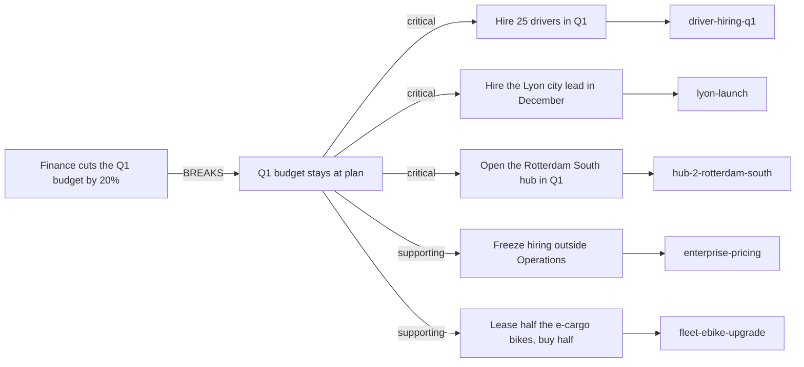

# decision-ripple

A decision log that notices when its assumptions break.

## Use case

Teams write down what they decided, but rarely what each decision assumed. When the budget is cut or a supplier slips, nobody can say which live decisions just lost their footing. The ones that matter get found late, by whoever trips over them. This graph keeps decisions, the assumptions under them, the projects they steer and the people behind them as plain markdown notes. One new signal returns the decisions at risk, how critical each is, and who to tell. AI agents read the same graph before they plan work, so they don't build on a decision someone already replaced.

The sample company is made up: **Kestrel Cargo**, a cargo-bike delivery firm in Rotterdam with
10 people, 8 projects and 24 decisions. The relationships that matter:

- A **decision rests on assumptions**. Some are critical, some only support it.
- A **decision steers projects**, and **people** made it, own the project or hold a stake.
- A **signal** (a report, a memo, a supplier notice) **confirms, supports, weakens or breaks** an assumption.
- A newer decision **supersedes** or **amends** an older one.

So one new fact can reach decisions, projects and people that never mention it. The graph
finds them. A flat list of notes cannot.

A budget cut is the shape of that walk. The signal never has to mention a hub, a hiring plan, or a person:



The tell list starts with **olu-adeyemi** (Head of Operations) and **priya-raman** (Head of Finance), 3 critical decisions each.

## How it uses Relate

- **Mode: directory.** The store is `vault/`, a folder of markdown notes read by Relate's
  markdown codec.
- **Why this mode:**
  - The store is the notes. People read and edit them in Obsidian or any editor. Git diffs
    show what changed and who changed it. A decision log people can't read is a decision log
    nobody keeps.
  - Cypher writes go back into the files. `scripts/add_signal.py` adds a signal with `MERGE` and
    a new note appears in `vault/Signal/`.
  - A directory store lets one process write while the MCP server follows along
    (`--read-only=live`). A single `.rl` file refuses live mode.
- **What the graph models:** 59 nodes and 142 relationships.

| Label | Count | Example |
|---|---|---|
| Decision | 24 | "Open the Rotterdam South hub in Q1" (status, confidence) |
| Assumption | 14 | "The Q1 budget stays at plan, EUR 2.4m" |
| Person | 10 | Head of Operations, Head of Finance, ... |
| Project | 8 | `hub-2-rotterdam-south`, `lyon-launch`, ... |
| Signal | 3 | "October driver churn was 6.9%" |

Relationships: `RESTS_ON` (with `weight: critical`, else supporting), `STEERS`, `DECIDED_BY`,
`OWNED_BY`, `STAKEHOLDER`, `SUPERSEDES`, `AMENDS`, `CONFIRMS`, `SUPPORTS`, `WEAKENS`, `BREAKS`.

A note looks like this. Frontmatter wikilinks become relationships:

```markdown
---
type: Signal
name: 2026-11-15-scan-coverage-88
title: Scan coverage was 88% of trips in October
source: Ops data check
BREAKS:
  - "[[Assumption/ops-data-complete]]"
---
```

## Setup and run

You need the Relate CLI (v1.1.0) and Python 3.12 or newer. The tests run on 3.12. No packages to install.

```bash
curl -sSfL https://relatedb.ai/install.sh | bash
```

The installer puts `relate` in `~/.local/bin`. If the shell says `relate: command not found`, add that directory to `PATH` and open a new terminal:

```bash
export PATH="$HOME/.local/bin:$PATH"
relate --version
```

The first time Relate runs, it prints: `relate collects anonymous usage metrics; disable anytime: relate telemetry off`. That line is about Relate's usage metrics. Turn them off and save the choice:

```bash
relate telemetry off
```

`relate telemetry status` prints whether they are on. For one shell, without saving a choice, `export RELATE_TELEMETRY=0` or `export DO_NOT_TRACK=1` turns them off.

```bash
git clone https://github.com/charlottebepbop/decision-ripple.git
cd decision-ripple
./scripts/demo.sh
```

`./scripts/demo.sh` is the whole story on a throwaway copy of the vault. It builds the index, prints the assumptions that are already broken, records one memo that hits two of them, replaces the Rotterdam South hub decision twice, and searches for why the mapping contract changed. The committed notes stay as they are. `examples/demo-script.md` is the shot list for filming that run.

Run the commands below from the repo root. They read `DECISION_VAULT` when it is set, and the sample `vault/` when it is not. Set that variable before you record anything of your own. See [Start your own vault](#start-your-own-vault).

**1. Ask the graph.** Build the full-text index once. It maps note bodies to the `text` property and indexes decision titles and bodies. `5-why` needs this index (`IndexDoesNotExist: decision_text` means it has not been built yet):

```bash
relate query --snapshot-format markdown --markdown-body-properties text \
  --database "${DECISION_VAULT:-vault}" --max-rows 0 \
  < queries/0-setup.cypher
```

Queries and `scripts/add_signal.py` take a **slug**, the filename without `.md`, not the title. `ops-data-complete` is the slug. "Delivery scans cover at least 95% of trips." is the statement. List them:

```bash
python3 scripts/list_slugs.py
python3 scripts/list_slugs.py assumption
python3 scripts/list_slugs.py project decision person
```

`--param` parses its value as JSON first, and a bare word is a string, so `--param assumption=ops-data-complete` is the form to paste. A phrase for `5-why` is a JSON string: `--param term='"annual mapping"'`. Queries 1, 3, 4, and 5 stop with `ParameterMissing` until that flag is present. Queries 2 and 6 take no parameter.

| Query | Question | Parameter |
|---|---|---|
| `1-ripple.cypher` | This assumption broke. Which live decisions rest on it, which projects do they steer, who must hear? | `assumption` |
| `2-fragile.cypher` | Which projects stand on 2 or more low-confidence decisions, and is any of the ground already hit? | none |
| `3-precheck.cypher` | Before working on a project: what binds it, what replaced old decisions, what is under pressure? | `project` |
| `4-tell.cypher` | The ripple, turned around per person, most exposed first | `assumption` |
| `5-why.cypher` | Why did we decide this? Full-text `SEARCH` over decision notes, then who decided, what it rests on, what replaced it | `term` |
| `6-exposed.cypher` | What is already broken? Which live decisions still rest on an assumption a signal has weakened or broken? | none |

```bash
relate query --snapshot-format markdown --markdown-body-properties text \
  --database "${DECISION_VAULT:-vault}" --mode table --max-rows 0 \
  --param assumption=ops-data-complete \
  < queries/1-ripple.cypher
```

On the sample vault: four live decisions, three of them critical (the ops dashboard, the route optimizer, and training the optimizer on scan data).

```bash
relate query --snapshot-format markdown --markdown-body-properties text \
  --database "${DECISION_VAULT:-vault}" --mode table --max-rows 0 \
  < queries/2-fragile.cypher
```

On the sample vault: `route-optimizer-v2` (3 low-confidence decisions), `customer-sla-program` (2), and `ops-dashboard` (2).

```bash
relate query --snapshot-format markdown --markdown-body-properties text \
  --database "${DECISION_VAULT:-vault}" --mode table --max-rows 0 \
  --param project=hub-2-rotterdam-south \
  < queries/3-precheck.cypher
```

On the sample vault: the Q1 hub opening, the runway plan, and staffing the south hub from the north hub, all still live.

```bash
relate query --snapshot-format markdown --markdown-body-properties text \
  --database "${DECISION_VAULT:-vault}" --mode table --max-rows 0 \
  --param assumption=q1-budget-holds \
  < queries/4-tell.cypher
```

On the sample vault: eight people, **olu-adeyemi** and **priya-raman** first, with 3 critical decisions each.

```bash
relate query --snapshot-format markdown --markdown-body-properties text \
  --database "${DECISION_VAULT:-vault}" --mode table --max-rows 0 \
  --param term=mapping \
  < queries/5-why.cypher
```

A phrase uses JSON quotes. On the sample vault both forms find the annual mapping contract, the monthly contract that replaced it, and the in-house optimizer:

```bash
relate query --snapshot-format markdown --markdown-body-properties text \
  --database "${DECISION_VAULT:-vault}" --mode table --max-rows 0 \
  --param term='"annual mapping"' \
  < queries/5-why.cypher
```

```bash
relate query --snapshot-format markdown --markdown-body-properties text \
  --database "${DECISION_VAULT:-vault}" --mode table --max-rows 0 \
  < queries/6-exposed.cypher
```

On the sample vault: scan coverage breaks four live decisions, and the supplier slip weakens the bike lease.

**2. Record a new signal.** From the repo root:

```bash
python3 scripts/add_signal.py q1-budget-holds BREAKS "Finance cuts the Q1 budget by 20%" --source "Board memo"
```

This writes `Signal/<date>-finance-cuts-the-q1-budget-by-20.md` in `DECISION_VAULT` (or in `vault/` when that is unset) and a brief in `DECISION_BRIEFS` (or in `briefs/`): 5 live decisions at risk (3 critical) and 8 people to tell, most exposed first.

The filename is the date, a hyphen, and a slug of the title. The slug is lower case, punctuation becomes hyphens, and it is cut at 60 characters. A hyphen left on the end of that cut is dropped. `name` inside the file is that filename without `.md`. Pass the slug `python3 scripts/list_slugs.py` prints. `q1-budget-holds` is a slug. "The Q1 budget stays at plan, EUR 2.4m." is the statement.

Repeat `--and ASSUMPTION EFFECT` when one memo hits another assumption. One signal note gets
both edges, and the brief has a section per assumption and one tell list:

```bash
python3 scripts/add_signal.py q1-budget-holds BREAKS \
  "Finance cuts the Q1 budget and the bike supplier slips" \
  --and ebike-supplier-delivers-feb WEAKENS --source "Board memo"
```

`examples/briefs/` holds four briefs made this way on a fresh clone, so you can read the
output without running anything.
Effects are `BREAKS`, `WEAKENS`, `SUPPORTS` (evidence, not proof) and `CONFIRMS`.

**3. Record the decision that follows.** The hub's Q1 opening lost its budget, so it moves to Q2:

```bash
python3 scripts/add_decision.py "Open the Rotterdam South hub in Q2" \
  --project hub-2-rotterdam-south --by olu-adeyemi --by tomasz-wilk \
  --rests-on south-hub-lease-signed:critical --rests-on series-a-close-march \
  --supersedes 2026-07-29-open-south-hub-q1 --rationale "The Q1 budget was cut by 20%."
```

This writes a new note in `Decision/`, links it with `SUPERSEDES`, and sets the Q1
decision to `superseded`. The pre-check it prints now points from Q1 to Q2. A later decision
that supersedes Q2 is what the pre-check names for both: it walks `SUPERSEDES` (up to five
hops) and keeps the decision whose status is still `live`. Use `--amends`
for a change that keeps the old decision live.

**4. Let an agent use it.** `.mcp.json` runs `scripts/serve.sh`. The script builds the full-text index, then starts Relate's MCP server, read-only and live. With `DECISION_VAULT` set, the server reads that folder. With the variable unset, the server reads the sample `vault/`. The server offers two tools: `read_cypher` and `get_schema`. `CLAUDE.md` tells the agent which query to run, and to use slugs. With Claude Code:

```bash
claude
> I want to speed up the Rotterdam South hub. Anything I should know first?
> Why did we drop the annual mapping contract?
```

The agent runs `6-exposed` before it plans. On a fresh clone that is the scan-coverage break
under the route optimizer and the ops dashboard, and the supplier slip under the bike lease.
It finds the 3 decisions that steer the hub, then follows shared assumptions to
decisions that never name the hub: driver hiring, the hiring freeze, and a bike lease whose
supplier has flagged a slip. Run step 2, ask again, and the budget break shows up. Run step 3,
ask again, and the agent plans on the decision the pre-check still marks live.

**Reset** to the committed vault at any time:

```bash
git checkout -- vault && git clean -fdq vault
```

`python3 scripts/seed_vault.py` deletes `vault/` and writes the sample notes again. It leaves a `DECISION_VAULT` folder alone. Opening the vault leaves the notes as they are. Relate keeps its index in `vault/.cypherlite/`, and that folder is gitignored, so the first query does not change the files git tracks.

## Start your own vault

`vault/` is the Kestrel Cargo sample, and it is committed. `add_signal.py` and `add_decision.py` write there until you point them at a folder of your own. Create one outside the repo:

```bash
python3 scripts/init_vault.py "$HOME/notes/my-decisions"
export DECISION_VAULT="$HOME/notes/my-decisions"
export DECISION_BRIEFS="$HOME/notes/my-decisions-briefs"
```

`DECISION_VAULT` is the notes folder. The queries above, `list_slugs.py`, `add_signal.py`, `add_decision.py`, `check_vault.py`, and `scripts/serve.sh` all use it. `DECISION_BRIEFS` is where the "who to tell" brief is written. Leave it unset and the brief lands in this repo's `briefs/` folder.

Then add notes in this order, so every link has a file to point at:

1. A person (`templates/Person.md`).
2. A project they own (`templates/Project.md`).
3. An assumption (`templates/Assumption.md`).
4. A decision with `status: live` that rests on the assumption (`templates/Decision.md`). Keep one `RESTS_ON` link as a bare wikilink. The weight form (`weight: critical`) needs at least one bare `RESTS_ON` somewhere in the vault, or Relate refuses to open it.
5. `python3 scripts/check_vault.py`
6. The index command from step 1, then the same six queries. `${DECISION_VAULT:-vault}` is already your folder.

Open the folder in Obsidian and turn on the Templates core plugin. `init_vault.py` copies the templates to `.obsidian/templates`. Relate ignores a folder whose name starts with a dot, so that copy stays out of the graph. The rules for each note type are in the template and in `templates/README.md`: `name` matches the filename, decisions need `status: live`, critical and supporting `RESTS_ON` are written differently, and links are quoted `"[[Assumption/slug]]"`.

To point Claude Code at the same folder, set `DECISION_VAULT` in `.mcp.json` to the absolute path. Without this entry the assistant reads the sample:

```json
{
  "mcpServers": {
    "kestrel-decisions": {
      "command": "sh",
      "args": ["scripts/serve.sh"],
      "env": {
        "DECISION_VAULT": "/home/you/notes/my-decisions"
      }
    }
  }
}
```

A `DECISION_VAULT` already exported in the environment that launches Claude Code reaches `serve.sh` as well. Keep other markdown out of the notes folder. A `.md` file becomes a note, and the folder it sits in becomes its label.

## Tests and the vault check

Python 3.12 or newer, from the standard library. No packages to install. The scenario tests need the Relate CLI (v1.1.0). The vault check does not.

```bash
python3 -m unittest discover -s tests -v
python3 scripts/check_vault.py
```

The scenario tests copy `vault/` and set `DECISION_VAULT`, so the committed notes stay as they are. Each one says which decisions, people, and projects a signal should flag, and which it should leave alone.

`scripts/check_vault.py` reads the notes as files. Run it after you edit a note by hand. It exits with an error when a link is broken, mistyped, or would be dropped, when a link would make Relate create an empty note, when a note only has type and name, when a header field is missing or malformed (including a decision with no `status`, which then disappears from the ripple), when `name` does not match the filename (Relate then refuses every query), when a person or a note is duplicated, when no decision rests on an assumption, or when a decision rests on no assumption. The message says what to change. With no argument it checks `DECISION_VAULT` when that is set, and `vault/` otherwise. Pass a folder to check that folder instead.

`scripts/add_signal.py` refuses an empty assumption (the note Relate creates from a mistyped link) and names the closest real one.

## Where the data lives

`vault/` is the persistent store. One markdown file per node, one folder per label.
`vault/.cypherlite/` holds Relate's derived state and is not committed. Relate rebuilds it from
the notes on first open. That includes the full-text index, which `queries/0-setup.cypher` (or
`scripts/serve.sh`) recreates. Note bodies are the `text` property of each node.
`scripts/seed_vault.py` generates the notes, so the data can be
rebuilt from code.

## Notes on Relate

Found while building, all on v1.1.0:

- The map form for relationship properties needs at least one bare wikilink of that type
  somewhere in the vault. So supporting `RESTS_ON` links are bare, and only critical ones carry
  `weight`. A vault whose every `RESTS_ON` uses the weight form fails to open.
- `scripts/add_signal.py` and `scripts/add_decision.py` build the filename slug with `scripts/graph.py`. The slug is cut at 60 characters, and a hyphen left at the cut is removed. `name` is that filename without `.md`.
- The Python client has no markdown snapshot option, so the scripts in `scripts/` use the CLI.
- `--param` parses its value as JSON first. A bare word such as `ops-data-complete` is a string. `scripts/graph.py` JSON-quotes every value so a date stays a string.
- `relate serve` does not take `--markdown-body-properties`. `scripts/serve.sh` runs the index query first, which records that note bodies map to `text`.
- Relate collects anonymous usage metrics on first run. `relate telemetry off` saves the off switch. `RELATE_TELEMETRY=0` and `DO_NOT_TRACK=1` turn them off for one shell.
