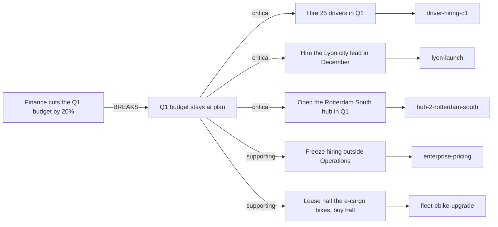

# decision-ripple

A decision log that notices when its assumptions break.

## Use case

Teams write down what they decided, but rarely what each decision assumed. When the budget is cut or a supplier slips, nobody can say which live decisions just lost their footing. The ones that matter get found late, by whoever trips over them. This graph keeps decisions, the assumptions under them, the projects they steer and the people behind them as plain markdown notes. One new signal returns the decisions at risk, how critical each is, and who to tell. AI agents read the same graph before they plan work, so they don't build on a decision someone already replaced.

The sample company is made up: **Kestrel Cargo**, a cargo-bike delivery firm in Rotterdam with
10 people, 8 projects and 24 decisions. The relationships that matter:

- A **decision rests on assumptions**. Some are critical, some only support it.
- A **decision steers projects**, and **people** made it, own the project or hold a stake.
- A **signal** (a report, a memo, a supplier notice) **confirms, supports, weakens or breaks** an assumption.
- A newer decision **supersedes** or **amends** an older one.

So one new fact can reach decisions, projects and people that never mention it. The graph
finds them. A flat list of notes cannot.

A budget cut is the shape of that walk. The signal never has to mention a hub, a hiring plan, or a person:



The tell list starts with **olu-adeyemi** (Head of Operations) and **priya-raman** (Head of Finance), 3 critical decisions each.

## How it uses Relate

- **Mode: directory.** The store is `vault/`, a folder of markdown notes read by Relate's
  markdown codec.
- **Why this mode:**
  - The store is the notes. People read and edit them in Obsidian or any editor. Git diffs
    show what changed and who changed it. A decision log people can't read is a decision log
    nobody keeps.
  - Cypher writes go back into the files. `scripts/add_signal.py` adds a signal with `MERGE` and
    a new note appears in `vault/Signal/`.
  - A directory store lets one process write while the MCP server follows along
    (`--read-only=live`). A single `.rl` file refuses live mode.
- **What the graph models:** 59 nodes and 142 relationships.

| Label | Count | Example |
|---|---|---|
| Decision | 24 | "Open the Rotterdam South hub in Q1" (status, confidence) |
| Assumption | 14 | "The Q1 budget stays at plan, EUR 2.4m" |
| Person | 10 | Head of Operations, Head of Finance, ... |
| Project | 8 | `hub-2-rotterdam-south`, `lyon-launch`, ... |
| Signal | 3 | "October driver churn was 6.9%" |

Relationships: `RESTS_ON` (with `weight: critical`, else supporting), `STEERS`, `DECIDED_BY`,
`OWNED_BY`, `STAKEHOLDER`, `SUPERSEDES`, `AMENDS`, `CONFIRMS`, `SUPPORTS`, `WEAKENS`, `BREAKS`.

A note looks like this. Frontmatter wikilinks become relationships:

```markdown
---
type: Signal
name: 2026-11-15-scan-coverage-88
title: Scan coverage was 88% of trips in October
source: Ops data check
BREAKS:
  - "[[Assumption/ops-data-complete]]"
---
```

## Setup and run

You need the Relate CLI (tested on v1.1.0) and Python 3 (tested on 3.14). No Python packages.

```bash
curl -sSfL https://relatedb.ai/install.sh | bash
relate --version

git clone https://github.com/charlottebepbop/decision-ripple.git
cd decision-ripple
./scripts/demo.sh
```

`./scripts/demo.sh` is the whole story on a throwaway copy of the vault. It builds the index, prints the assumptions that are already broken, records one memo that hits two of them, replaces the Rotterdam South hub decision twice, and searches for why the mapping contract changed. The committed notes stay as they are. `examples/demo-script.md` is the shot list for filming that run.

**1. Ask the graph.** First build the full-text index once. It maps note bodies to the `text`
property and indexes decision titles and bodies:

```bash
cd vault
relate query --snapshot-format markdown --markdown-body-properties text --database . \
  < ../queries/0-setup.cypher
```

Then run any of the six queries in `queries/`:

```bash
relate query --snapshot-format markdown --database . --mode table \
  < ../queries/6-exposed.cypher
```

| Query | Question | Parameter |
|---|---|---|
| `1-ripple.cypher` | This assumption broke. Which live decisions rest on it, which projects do they steer, who must hear? | `assumption` |
| `2-fragile.cypher` | Which projects stand on 2 or more low-confidence decisions, and is any of the ground already hit? | none |
| `3-precheck.cypher` | Before working on a project: what binds it, what replaced old decisions, what is under pressure? | `project` |
| `4-tell.cypher` | The ripple, turned around per person, most exposed first | `assumption` |
| `5-why.cypher` | Why did we decide this? Full-text `SEARCH` over decision notes, then who decided, what it rests on, what replaced it | `term` |
| `6-exposed.cypher` | What is already broken? Which live decisions still rest on an assumption a signal has weakened or broken? | none |

**2. Record a new signal.** From the repo root:

```bash
python3 scripts/add_signal.py q1-budget-holds BREAKS "Finance cuts the Q1 budget by 20%" --source "Board memo"
```

This writes `vault/Signal/<date>-finance-cuts-the-q1-budget-by-20.md` and a brief in
`briefs/`: 5 live decisions at risk (3 critical) and 8 people to tell, most exposed first.
Repeat `--and ASSUMPTION EFFECT` when one memo hits another assumption. One signal note gets
both edges, and the brief has a section per assumption and one tell list:

```bash
python3 scripts/add_signal.py q1-budget-holds BREAKS \
  "Finance cuts the Q1 budget and the bike supplier slips" \
  --and ebike-supplier-delivers-feb WEAKENS --source "Board memo"
```

`examples/briefs/` holds four briefs made this way on a fresh clone, so you can read the
output without running anything.
Effects are `BREAKS`, `WEAKENS`, `SUPPORTS` (evidence, not proof) and `CONFIRMS`.

**3. Record the decision that follows.** The hub's Q1 opening lost its budget, so it moves to Q2:

```bash
python3 scripts/add_decision.py "Open the Rotterdam South hub in Q2" \
  --project hub-2-rotterdam-south --by olu-adeyemi --by tomasz-wilk \
  --rests-on south-hub-lease-signed:critical --rests-on series-a-close-march \
  --supersedes 2026-07-29-open-south-hub-q1 --rationale "The Q1 budget was cut by 20%."
```

This writes a new note in `vault/Decision/`, links it with `SUPERSEDES`, and sets the Q1
decision to `superseded`. The pre-check it prints now points from Q1 to Q2. A later decision
that supersedes Q2 is what the pre-check names for both: it walks `SUPERSEDES` (up to five
hops) and keeps the decision whose status is still `live`. Use `--amends`
for a change that keeps the old decision live.

**4. Let an agent use it.** `.mcp.json` runs `scripts/serve.sh`. It builds the full-text index,
then starts Relate's MCP server on the vault, read-only and live. It offers two tools: `read_cypher` and `get_schema`. `CLAUDE.md` tells the agent to run
the pre-check before it plans work on a project. With Claude Code:

```bash
claude
> I want to speed up the Rotterdam South hub. Anything I should know first?
> Why did we drop the annual mapping contract?
```

The agent runs `6-exposed` before it plans. On a fresh clone that is the scan-coverage break
under the route optimizer and the ops dashboard, and the supplier slip under the bike lease.
It finds the 3 decisions that steer the hub, then follows shared assumptions to
decisions that never name the hub: driver hiring, the hiring freeze, and a bike lease whose
supplier has flagged a slip. Run step 2, ask again, and the budget break shows up. Run step 3,
ask again, and the agent plans on the decision the pre-check still marks live.

**Reset** to the committed vault at any time:

```bash
git checkout -- vault && git clean -fdq vault
```

`python3 scripts/seed_vault.py` rebuilds the notes from code. Relate rewrites them into its own
field order on first open, so expect a one-time diff.

## Tests and the vault check

Python 3 only, from the standard library. No packages to install. The scenario tests need the Relate CLI (v1.1.0). The vault check does not.

```bash
python3 -m unittest discover -s tests -v
python3 scripts/check_vault.py
```

The scenario tests copy `vault/` and set `DECISION_VAULT`, so the committed notes stay as they are. Each one says which decisions, people, and projects a signal should flag, and which it should leave alone.

`scripts/check_vault.py` reads the notes as files. It exits with an error when a link is broken, mistyped, or would be dropped, when a link would make Relate create an empty note, when a note only has type and name, when a header field is missing or malformed (including a decision with no `status`, which then disappears from the ripple), when `name` does not match the filename (Relate then refuses every query), when a person or a note is duplicated, when no decision rests on an assumption, or when a decision rests on no assumption. The message says what to change. Pass another folder to check that instead of `vault/`.

`scripts/add_signal.py` refuses an empty assumption (the note Relate creates from a mistyped link) and names the closest real one.

## Where the data lives

`vault/` is the persistent store. One markdown file per node, one folder per label.
`vault/.cypherlite/` holds Relate's derived state and is not committed. Relate rebuilds it from
the notes on first open. That includes the full-text index, which `queries/0-setup.cypher` (or
`scripts/serve.sh`) recreates. Note bodies are the `text` property of each node.
`scripts/seed_vault.py` generates the notes, so the data can be
rebuilt from code.

## Notes on Relate

Found while building, all on v1.1.0:

- The map form for relationship properties needs at least one bare wikilink of that type
  somewhere in the vault. So supporting `RESTS_ON` links are bare, and only critical ones carry
  `weight`.
- The Python client has no markdown snapshot option, so the scripts in `scripts/` use the CLI.
- `--param` parses its value as JSON first. `scripts/graph.py` JSON-quotes every value so a date stays
  a string.
- `relate serve` does not take `--markdown-body-properties`.
